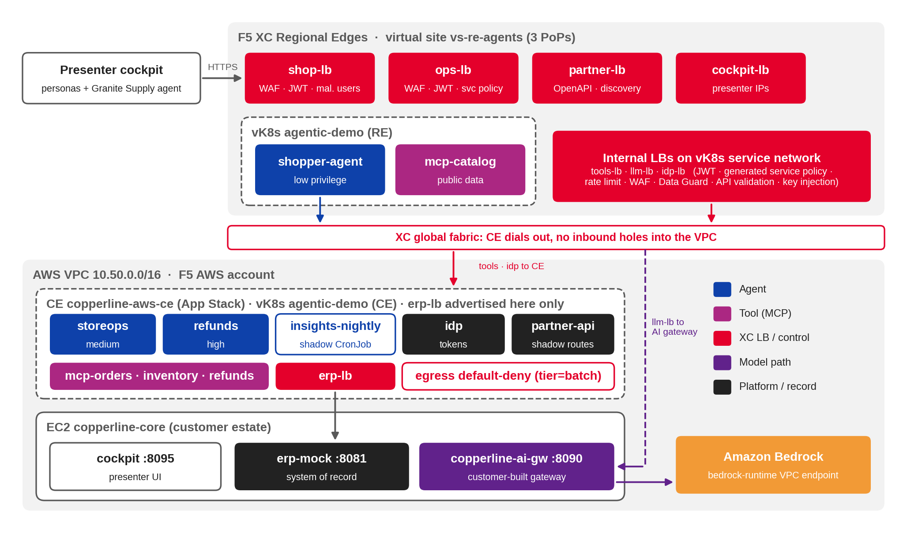

# 01 Architecture

## Topology



ASCII version (for terminals):

```
                         Internet (presenter browser → cockpit-lb; cockpit backend also plays the Granite Supply agent)
                                   │                 │                  │
                     shop.<DOMAIN> │   ops.<DOMAIN>  │  partner.<DOMAIN>│
                                   ▼                 ▼                  ▼
 ┌──────────────── F5 XC Regional Edges (virtual site: vs-re-agents, 3 PoPs) ────────────────┐
 │  shop-lb (WAF, JWT, malicious users)   ops-lb (WAF, JWT, svc policy)   partner-lb (OpenAPI) │
 │                                                                                             │
 │  vK8s namespace agentic-demo (RE part)                                                      │
 │   ┌──────────────────┐   ┌──────────────────┐                                               │
 │   │ shopper-agent    │   │ mcp-catalog      │  (public catalog snapshot, incl. reviews)    │
 │   └──────┬───────────┘   └──────────────────┘                                               │
 │          │ internal LBs advertised on "vK8s service network on RE":                          │
 │          │   tools.agentic-demo   llm.agentic-demo   idp.agentic-demo                        │
 └──────────┼──────────────────────────────────────────────────────────────────────────────────┘
            │  XC global fabric (CE dials out; no inbound holes into the VPC)
 ┌──────────┼────────────── AWS VPC 10.50.0.0/16 (F5 AWS account) ─────────────────────────────┐
 │  ┌───────▼──────────── CE site copperline-aws-ce (App Stack, virtual site vs-ce-aws) ─────┐ │
 │  │ internal LBs also advertised on the CE vK8s service network                              │ │
 │  │ (+ erp.agentic-demo, CE only)                                                            │ │
 │  │  vK8s namespace agentic-demo (CE part)                                                   │ │
 │  │   storeops-agent   refunds-agent   insights-nightly (CronJob, the "shadow" agent)        │ │
 │  │   mcp-orders  mcp-inventory  mcp-refunds   partner-api   idp                             │ │
 │  └───────────────────────────────┬─────────────────────────────────────────────────────────┘ │
 │                                  │ origin pools by private IP (CE inside network)            │
 │  ┌───────────────────────────────▼──────────────────────┐   ┌───────────────────────────┐    │
 │  │ EC2 copperline-core (customer estate, docker compose) │──▶│ VPC endpoint:             │    │
 │  │   erp-mock :8081    copperline-ai-gw :8090            │   │ bedrock-runtime           │──▶ Amazon Bedrock
 │  └──────────────────────────────────────────────────────┘   └───────────────────────────┘    │
 └───────────────────────────────────────────────────────────────────────────────────────────────┘
```

## Design principles

1. **Every crossing is an XC load balancer.** Agents never call a pod or IP directly. They call the internal LBs by short domain: `http://tools.agentic-demo`, `http://llm.agentic-demo`, `http://idp.agentic-demo` and `http://erp.agentic-demo`. (The XC LB *objects* are named `tools-lb`, `llm-lb`, `idp-lb` and `erp-lb`; the *domains* drop the `-lb`.) XC publishes those names into the vK8s service network of the sites where each LB is advertised.
2. **The customer estate stays the customer's.** The ERP and the AI gateway run on a plain EC2 host that Copperline "already owned". XC brings the agents to that estate and governs access to it. It does not replace the customer's gateway.
3. **Placement follows privilege.** Low-privilege, public-data components run on REs: `shopper-agent` and `mcp-catalog`. Anything that can write or read PII runs on the CE: all other agents, tool servers, the IdP and the partner API.
4. **Segmentation is done by advertisement.** `erp.agentic-demo` is advertised **only** on the CE. RE workloads have no name and no route to the system of record.
5. **Agents are stateless.** The client sends the full conversation history with each turn. That makes RE replication safe without session affinity. Docs mention affinity as the alternative.

## Naming

| Thing | Name |
|---|---|
| XC namespace | `agentic-demo` |
| vK8s object | `agentic-demo-vk8s` (virtual sites: `vs-re-agents`, `vs-ce-aws`) |
| RE virtual site | `vs-re-agents`: 3 REs chosen near the presenter, e.g. US-East, US-West and EU. Use the tenant's actual RE site names (TODO verify) |
| CE site | `copperline-aws-ce` (AWS VPC site, App Stack cluster, **two interfaces**: outside + inside; EC2 origins are reached on the inside network) |
| CE virtual site | `vs-ce-aws`: label selector `copperline.demo/site = aws-ce` |
| Public domain | `<DEMO_DOMAIN>`, a delegated subdomain in XC, e.g. `copperline.<team-domain>` |
| Internal LB domains | `tools.agentic-demo`, `llm.agentic-demo`, `idp.agentic-demo`, `erp.agentic-demo` (format `<name>.<namespace>`, required for vK8s service network advertisement) |
| K8s Services | Must **not** collide with internal LB names. Use `svc-<component>`, e.g. `svc-mcp-orders` |

## Traffic flows

| # | Flow | Path | XC controls on the path |
|---|---|---|---|
| F1 | Customer → Shopper Assistant | laptop → shop-lb (RE) → shopper-agent (RE) | WAF, JWT (aud `copperline-shop`), malicious user detection, per-user rate limit |
| F2 | Associate or care rep → Store Ops or Refunds Desk | laptop → ops-lb (RE) → storeops-agent / refunds-agent (CE) | WAF, JWT (aud `copperline-ops`), service policy (role → path) |
| F3 | Agent → IdP token exchange | agent → idp.agentic-demo → idp (CE) | Service policy `sp-idp` (only `POST /token/exchange`, `POST /auth/token`, `GET /.well-known/*`) |
| F4 | Agent → tools | agent → tools.agentic-demo → mcp-* (RE or CE) | JWT (aud `copperline-tools`), **generated** per-tool service policy, rate limiter, WAF, Data Guard, API discovery |
| F5 | Agent → model | agent → llm.agentic-demo → copperline-ai-gw (EC2) → Bedrock | JWT (aud `copperline-llm`), generated service policy (agent role × obo role × `x-model-route`), per-agent rate limit, gateway key injected by XC |
| F6 | Tools → system of record | mcp-* (CE) → erp.agentic-demo → erp-mock (EC2) | JWT (aud `copperline-erp`, service tokens), WAF, CE-only advertisement |
| F7 | Partner agent → partner API | laptop → partner-lb (RE) → partner-api (CE) | JWT (aud `copperline-partner`), OpenAPI validation (block, fall-through block), API discovery, sensitive data discovery, per-client rate limit |
| F8 | Shadow agent egress | insights-nightly (CE) → internet | vK8s network policy default-deny egress (CE) |

## Ports

- Containers: 8080 (all vK8s services).
- EC2: erp-mock 8081, copperline-ai-gw 8090, cockpit 8095. The security group allows all three **only from the CE inside subnet**. erp-mock admin (8181) and AI gateway admin (8190: usage and reset) are published on the host loopback only.
- Internal LBs listen on HTTP 80 on the vK8s service network. Site-to-site traffic is encrypted by the XC fabric. TLS on internal LBs is a stretch goal.
- Public LBs: HTTPS 443 with XC auto-cert on `<DEMO_DOMAIN>`.
- Local mode (no XC): the front doors are published as `127.0.0.1:8001` (shop), `8002` (ops) and `8003` (partner), and the internal LBs keep their names and port 80 on the compose network. See `deploy/local/README.md`.

## Why this topology tells the story

| Deck claim | Where the demo shows it |
|---|---|
| RA1: public edge agents | shopper-agent on 3 REs, plus mcp-catalog co-located on RE |
| RA2: private enterprise agents | storeops and refunds on the CE beside the ERP, with no public VIP for the ERP |
| RA3: hybrid public → private (hero) | shopper-agent (RE) → tools-lb → mcp-orders (CE) → erp (EC2) |
| Fabric as control plane | Every flow F1–F8 runs through an XC LB carrying policy |
| Customer-owned AI gateway | copperline-ai-gw on EC2: XC governs who reaches it, the gateway governs tokens and models |
